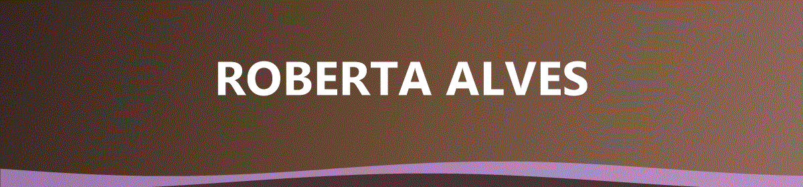

<h3 align="center">Desenvolvedora Front-End em formação</h3>

---

## 👩‍💻 Sobre mim

🎓 Estudante de **Análise e Desenvolvimento de Sistemas** na Faculdade ENIAC.

💻 Desenvolvedora **Front-End em formação**, ampliando meus conhecimentos em desenvolvimento Full Stack.

🚀 Desenvolvo projetos práticos utilizando **HTML, CSS, JavaScript, Node.js e APIs**, aplicando conceitos de responsividade, validação de dados e integração entre front-end e back-end.

🌎 Inglês avançado e experiência profissional em ambientes multiculturais, com foco em comunicação, resolução de problemas e trabalho em equipe.

📚 Atualmente aprofundando meus estudos em **React, bancos de dados e computação em nuvem**.

🎯 Em busca de oportunidades de **estágio em desenvolvimento de software**, com foco em Front-End ou Full Stack.

🚗 **Do Volante para a Tela:** transformando minha experiência profissional em uma nova trajetória na tecnologia.
---

## 🚀 Tecnologias e Ferramentas

### 💻 Tecnologias utilizadas

  

### 📚 Em aprendizado

  

# 🌟 Projetos em destaque

| Projeto | Descrição |
|----------|-----------|
| 🌐 **Portfólio** | Meu portfólio desenvolvido do zero utilizando HTML, CSS e JavaScript. |
| 🚗 DriveFlow® | Aplicação para controle financeiro criada a partir de uma necessidade do dia a dia. |
| 📱 **Unidos Amém** | Projeto voluntario para ONG, com interface moderna, responsivas e focadas na experiência do usuário. |
| 🎯 **DF Tapeçaria STANDS e Cenografia** | Projeto voltado para apresentação de empresa para mercado. |

---
# 🔥 Sequência de Contribuições

---

# 📫 Vamos nos conectar

&nbsp;

---

## 🚗 Do Volante para a Tela 💻

*"Transformando experiência em código e construindo o próximo capítulo da minha trajetória."*

